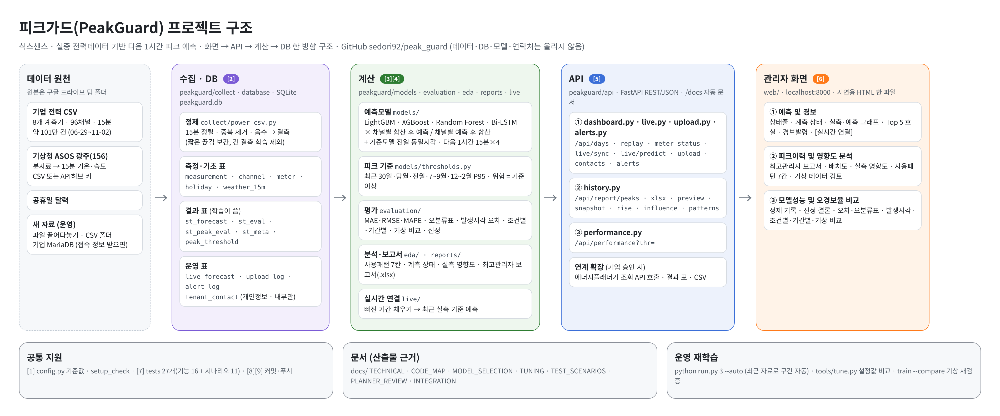
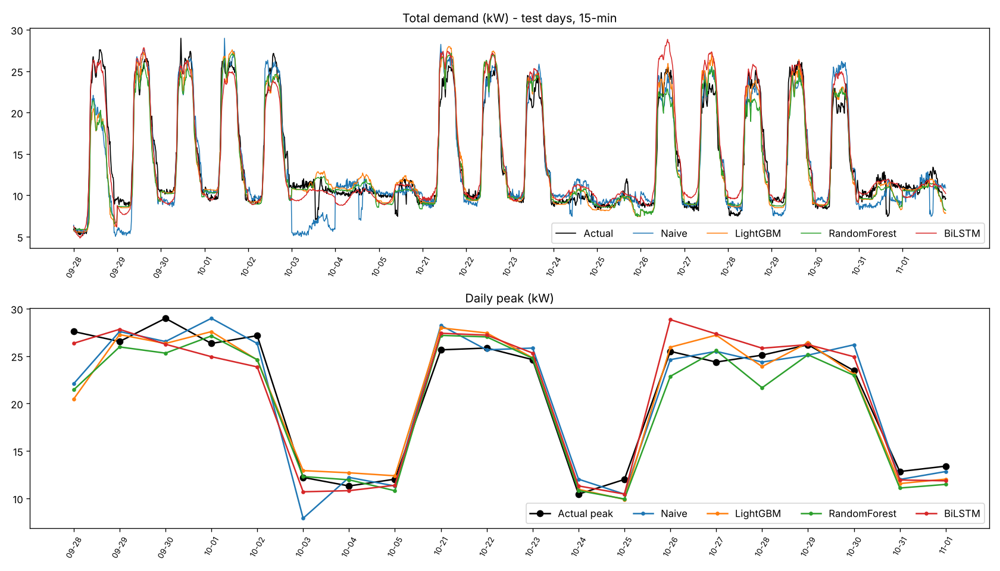

# 피크가드 (PeakGuard) — 실증 전력데이터 기반 피크 예측·관제

생활지원로봇센터(1~4층) 전력량계 8대·채널 96개의 15분 수요전력(약 101만 건)을 **SQLite DB**에 적재하고,
**다음 1시간(15분 × 4)** 의 건물 전체·호실 채널 수요전력을 예측해 **관리자 화면 3개**(① 예측 및 경보 · ② 피크이력 및 영향도 분석 · ③ 모델성능 및 오경보율 비교)에 연결합니다. (화면 설계 v0.2)



- 기술문서: **[docs/TECHNICAL.md](docs/TECHNICAL.md)** · 화면-API-DB 연결표: **[docs/CODE_MAP.md](docs/CODE_MAP.md)** · 모델 선정 근거: **[docs/MODEL_SELECTION.md](docs/MODEL_SELECTION.md)** · 설정값 비교: **[docs/TUNING.md](docs/TUNING.md)**
- 시나리오 테스트: **[docs/TEST_SCENARIOS.md](docs/TEST_SCENARIOS.md)** · 에너지플래너 적용 가능성·개선 방향: **[docs/PLANNER_REVIEW.md](docs/PLANNER_REVIEW.md)** · 기업 시스템(MariaDB) 연계: **[docs/INTEGRATION.md](docs/INTEGRATION.md)**
- 팀원별 담당 폴더: **[docs/TEAM.md](docs/TEAM.md)** · 깃허브 공동 작업 순서: **[docs/GITHUB_GUIDE.md](docs/GITHUB_GUIDE.md)**

## 1. 실행 — 번호만 입력하면 됩니다
```bash
pip install -r requirements.txt
# 데이터 넣기: data/raw/ 에 전력 CSV 8개, data/weather/ 에 ASOS 분자료 CSV (구글 드라이브 팀 폴더)

python run.py 1        # 1. 환경설정 점검
python run.py 2        # 2. 데이터베이스 구축 (SQLite peakguard.db, 약 15초)
python run.py 3        # 3. 예측모델 학습·평가·저장 (LightGBM·XGBoost·RandomForest·Bi-LSTM × 2개 방식, 약 8분)
                       #    --auto : 운영 재학습 — 마지막 실측 기준으로 시험 14일·검증 21일·나머지 학습 자동 구간
python run.py 4        # 4. 예측모델별 평가 결과 표·그래프 → reports/eval/
python run.py 5        # 5. API 서버 + 관리자 화면 → http://localhost:8000  (API 문서 /docs)
python run.py 6        # 6. 화면: 서버 없이 열리는 시연용 HTML (세 화면·시험기간 14일·8개 모델 포함)
python run.py 7        # 7. 동작확인 (자동 시험 27개 = 기능 16 + 관리자 시나리오 11)
python run.py 8 -m "[파트] 내용"   # 8. 깃허브 반영(커밋)
python run.py 9        # 9. 깃허브 푸시
python run.py 10 --period week --date 2026-10-28   # 10. 주간·월간 보고서 텍스트
python run.py 10x --period month --date 2026-10-15 # 10x. 최고관리자 피크 보고서 스프레드시트(.xlsx)
python run.py 11 --file 새파일.csv                  # 11. CSV → API 업로드 (5번 서버 실행 중일 때)
python run.py eda      # 사용패턴·피크 분석 그래프 → reports/eda/

python -m peakguard.tools.tune           # 설정값(하이퍼파라미터) 비교 → models/tuning.json
python -m peakguard.tools.model_report   # 선정 근거·설정값 문서 다시 쓰기 → docs/MODEL_SELECTION.md, docs/TUNING.md
python -m peakguard.models.train --compare   # 기상 포함/미포함 비교 학습 → models/compare_weather.json
```

## 2. 폴더 구조 — 화면 · API · DB 로 나뉜 모듈 (번호 = run.py 단계)

화면(web/) → API(peakguard/api/) → 계산 모듈(models·evaluation·eda·reports·live) → DB(peakguard.db) 순서로 한 방향으로만 부릅니다.
파일마다 맨 위 설명에 **"연결 ─ 화면 / API / DB"** 세 줄이 있고, 전체 표는 [docs/CODE_MAP.md](docs/CODE_MAP.md) 에 있습니다.

```
peak_guard/
├─ run.py                       번호별 실행기
├─ requirements.txt · .env.example (DB 주소·기업 DB·기상 API·메일 설정 예시)
├─ db/schema.sql                [2] DB 테이블 정의서 (SQLite, MariaDB 로 옮길 때 기준)
├─ peakguard/
│  ├─ config.py                 [1] 기간·피크 기준·위험 판정·기본 모델 등 기준값 (공통)
│  ├─ setup_check.py            [1] 환경 점검
│  │
│  │  ── 수집·DB ──────────────────────────────────────────────
│  ├─ collect/                  데이터 수집·전처리
│  │   ├─ power_csv.py              전력 CSV 정제 규칙 (DB 구축·파일 끌어다놓기·실시간 연결 공통)
│  │   ├─ weather.py                기상청 ASOS → 15분 집계, CSV·API 증분 업데이트
│  │   ├─ calendar_kr.py            주말·공휴일 달력
│  │   └─ reviews.py                공개 앱 리뷰 수집 (화면 설계 근거, 예측과 무관)
│  ├─ database/                 [2] DB 구축 (SQLAlchemy — .env 의 DATABASE_URL 로 다른 DB 전환)
│  │   ├─ connection.py             연결·기본 표 (measurement·channel·meter·holiday)
│  │   ├─ tables_forecast.py        기상·예측·평가 표 (weather_15m·st_*·peak_threshold)
│  │   ├─ tables_ops.py             운영 표 (live_forecast·tenant_contact·alert_log·upload_log)
│  │   └─ load_power.py             전력 CSV 적재
│  │
│  │  ── 계산 (화면이 보여 줄 숫자를 만드는 곳) ─────────────────────
│  ├─ models/                   [3] 예측모델
│  │   ├─ grid.py                   DB → 15분 격자, 음수 정제
│  │   ├─ thresholds.py             피크 기준 5종 (최근 30일·당월·전월·7~9월·12~2월 P95)·96채널 합계 최대
│  │   ├─ features.py               입력 특징
│  │   ├─ baseline.py               기준모델 (전일 동일시각)
│  │   ├─ lightgbm_model.py · xgboost_model.py · random_forest_model.py · bilstm_model.py
│  │   └─ train.py                  학습·예측·평가·DB 저장 (--auto 자동 구간, --compare 기상 비교)
│  ├─ evaluation/               [4] 평가 (③ 화면)
│  │   ├─ metrics.py                MAE·RMSE·MAPE·피크 오분류표
│  │   ├─ peak_by_threshold.py      피크 기준별 오분류표 다시 판정
│  │   ├─ extra.py                  선정 결론·발생시각 오차·조건별·기간별·기상 비교
│  │   └─ report.py                 보고용 표·그래프 (run.py 4)
│  ├─ eda/                      분석 (② 화면·① 계측 상태)
│  │   ├─ analysis.py               사용패턴 분석 7칸
│  │   ├─ meter_status.py           계측 상태 (끊김·빠진 칸·음수·누적 감소·불일치·값 고정)
│  │   └─ patterns.py               보고용 그래프 (run.py eda)
│  ├─ reports/                  [10] 보고서 (② 화면)
│  │   ├─ executive.py              최고관리자 보고서·스프레드시트
│  │   ├─ influence.py              평소 대비 증가·실측 영향도
│  │   └─ periodic.py               주간·월간 텍스트 보고서
│  ├─ live/                     [실시간 연결] sync.py 빠진 기간 채우기 · predictor.py 최근 실측 기준 예측
│  │
│  │  ── API (화면과 계산 사이 창구, FastAPI REST/JSON) ──────────────
│  ├─ api/                      [5] API 서버
│  │   ├─ app.py                    서버 시작·화면 파일 내보내기·상태 확인
│  │   ├─ dashboard.py              ① 예측 및 경보 — 재생·계측 상태
│  │   ├─ live.py                   ① [실시간 연결] 버튼
│  │   ├─ upload.py                 ① [파일 끌어다놓기] · [11] CSV 업로드
│  │   ├─ alerts.py                 ① 경보발령 선택 (연락처·경보 발령)
│  │   ├─ history.py                ② 최고관리자 보고서·배치도·영향도·사용패턴
│  │   ├─ performance.py            ③ 모델성능 및 오경보율 비교
│  │   └─ common.py                 공통 도구 (DB 조회)
│  ├─ tools/                    [6] export_static.py 시연 파일 · [11] send_csv.py · tune.py 설정값 비교 · model_report.py 문서 생성
│  └─ dayahead/                 (부록) 하루 전 일 피크 예측 — 기업 1차 답변 C3 로 이번 범위 제외, 화면·API 와 연결 없음
│
│  ── 화면 (Front-end) ────────────────────────────────────────
├─ web/                         [6] 관리자 화면
│  ├─ index.html                화면 배치 (탭 3개)
│  └─ static/
│      ├─ common.js                 세 화면 공통 도구 (API 부르기·그리기)
│      ├─ screen1_predict.js        ① 예측 및 경보 — 그래프·상태줄·계측 상태·[실시간 연결]
│      ├─ screen1_alerts.js         ① 경보발령 선택 상자
│      ├─ screen2_history.js        ② 최고관리자 보고서·배치도·영향도
│      ├─ screen2_patterns.js       ② 사용패턴 분석 7칸·기상 데이터 검토
│      ├─ screen3_perf.js           ③ 모델성능 및 오경보율 비교
│      ├─ app.js                    탭·하위 메뉴 전환 (#history/report 처럼 주소로 바로 열기) · bg.js 배경 · style.css
├─ tests/                       [7] test_smoke.py 기능 시험 · test_scenarios.py 관리자 시나리오 시험
├─ docs/                        기술문서·연결표·모델 선정·설정값·시나리오·적용 가능성·연계·구조도
└─ .github/                     PR 양식 · CODEOWNERS(담당자 지정)
```

> 원본 데이터(`data/`), DB 파일, 학습된 모델(`models/`), 시연용 HTML·스프레드시트(`reports/`), 비밀번호(`.env`)는 깃허브에 올리지 않습니다. 입주자 연락처는 `peakguard.db` 안에만 있습니다.

## 3. 다음 1시간 예측 (요구사항 FR-AI-001~004)

- **발행 시각 t (15분마다)** 에 그때까지의 실측만으로 t+15·30·45·60분 수요전력(kW)을 예측. 발행 시점 최신 실측이 없으면 "예측 불가"
- **대상**: 건물 전체 합산 + 활성 채널 61개 (전 기간 0kW 채널 35개는 0으로 표시). DB에는 전체 + 호실 채널 34개 예측을 저장
- **입력 특징**: 현재 수요전력·현재전력 순간값, 15분~2시간 전 값, 15분 변화량, 최근 1시간 최대·4시간 평균, 전일·전주 같은 시각, 예측 시각·요일·주말/공휴일, 선행시간
- **기상(기업 과제: 기상데이터 연계·관계 분석·모델 비교)**: 기상청 ASOS 기온·습도를 연계·업데이트하고 두 번째 화면에서 관계를 분석, 기온(평소 대비·1시간 변화)을 넣은 학습과 뺀 학습을 비교(세 번째 화면 ⑤). 검증기간에서 효과가 없어 **현재 예측 입력에는 미채택**(`config.USE_WEATHER`), 겨울 자료로 재검증
- **전처리(기업 답변)**: 현재전력 음수(1.49%)는 결측 처리 — 1시간 이하 끊김만 보간, 긴 연속 구간은 학습 제외, 건수·비율은 학습 기록과 세 번째 화면에 표시
- **모델 4개 × 방식 2개** (화면 왼쪽 위 콤보버튼으로 고름) + 기준모델 **전일 동일시각**(기업 기준모델)
  - 예측모델: LightGBM · XGBoost · Random Forest · Bi-LSTM
  - **채널별 합산 후 예측**: 96개 채널을 먼저 더한 건물 합계를 바로 예측 (기업 권장, 기본값)
  - **채널별 예측 후 합산**: 채널 61개를 각각 예측해 같은 시각끼리 더함
  - 호실 숫자(Top5·피크 예측 가능성)는 두 방식 모두 같은 모델의 채널 예측
- **기간 나누기**: 학습 ~2026-09-14 · 검증 09-15~10-06(모델 고르기, Bi-LSTM 조기 종료) ·
  **시험 10-20 15:15 ~ 11-02 16:15 발행(1,155개 공통 표본)**. 10/6 15시~10/20 15시는 통신회선 교체로 수집 중단
- **피크 기준**: 날짜별 직전 30일 건물 합산 15분 수요전력의 P95(95백분위수). **2단계**: 다음 1시간 예측 4칸 중 하나라도 기준 이상이면 "위험", 아니면 "정상" (예전 "주의"는 정상으로). 채널별 피크 선은 채널마다 같은 방식(직전 30일 P95)
  (확인: 10/1 기준값 27.49 kW = 기업 추가답변 3번의 9월 30일 P95 27.49 kW와 같음)
- **예측 설명**: LightGBM 전체 합산 1시간 뒤 예측의 SHAP(SHapley Additive exPlanations) 기여도(kW)

### 결과
모델별 성능·피크 경보 오분류표·발생시각 오차·조건별 정확도·기상 포함/미포함 비교와 **최적 모델 선정 근거**는
[docs/MODEL_SELECTION.md](docs/MODEL_SELECTION.md) (학습 후 `python -m peakguard.tools.model_report` 로 다시 생성)와 세 번째 화면에 있습니다.

### 화면 (web/) — 화면 설계 v0.2
1. **예측 및 경보**: 왼쪽 위 방식·예측모델·재생 기준일 선택 / 오른쪽 위 재생 배너 + **[실시간 연결]** /
   상태 띠 ① **96채널 합계 최대(분석용)**(직전 12개월 7~9월·12~2월·당월 최대, 공식 최대수요전력 아님) ② **피크 기준 콤보박스**(최근 30일·당월·전월·7~9월·12~2월의 95번째 백분위수) ③ 판정(정상·위험, 피크 기준 대비 %) ④ 현재 수요전력 /
   그 아래 **계측 상태** 줄(채널별 끊김·빠진 칸·음수·누적 감소·불일치·값 고정, [점검 필요 채널 보기]) /
   상단 실측·예측·피크 기준선 (위·아래 그래프 모두 '앞 2시간 실측 + 오른쪽 1/3 다음 1시간 예측', 시간이 지나면 왼쪽으로 밀림) / 오른쪽 **경보발령 선택**(공용부분 최후 수단 → 호실 34개, 안내문구, 연락처 관리, 경보 발령) /
   하단 Top5 호실 예측선 / 오른쪽 **호실별 피크 예측 가능성**(막대 = 호실 직전 30일 P95 대비 %, 옆에 예측 kW)
2. **피크이력 분석** (모두 실측, 하위 메뉴 1. 피크 보고서 · 2. 피크 원인(영향도) · 3. 사용패턴 · 4. 기상·이상 패턴): 최고관리자 보고서(일간·주간·월간·연간) — 피크 변동기록 | 피크 시각 **영향도 Top 10** | **평소 대비 증가 Top 10**
   (평소 = 같은 요일·시각 직전 4주 평균), [스프레드시트 보기·출력] / 고른 피크 시각의 층별 배치도 + **전체·채널별 영향도** 폭포 그래프
   (전체: 평소 건물 합계 + 채널별 증가 = 실측, 채널: 최근 4주 같은 시각 평균 + 요일·최근 1주·당일 차이 = 실측)
3. **모델 성능 비교** (하위 메뉴 1. 선정 결론 · 2. 방식별 성능 · 3. 정확도 상세 · 4. 기상 비교): 맨 위 피크 기준 콤보박스(첫 화면과 연동)·데이터 정제 기록 / 최적 모델 선정 결론 / 위 '채널별 합산 후 예측'(기업 권장), 아래 '채널별 예측 후 합산' — 오차 표 + 오분류표 + 재현율 비교 /
   ③ 예측시각·실제 발생시각 오차 ④ 조건별 정확도 ⑤ 기상 포함/미포함 비교 ⑥ 기간별(일별) 정확도
- 왼쪽 위 **피크가드 로고를 누르면 밝은 화면 ↔ 어두운 화면** 전환 (브라우저에 기억)

### 서버 안에서만 쓰는 장부 (화면에는 안 보이는 부분)
- **측정값 장부**(measurement): 15분 수요전력 원본. 같은 채널·시각은 한 번만 들어감 → [실시간 연결]·업로드를 여러 번 해도 중복 없음
- **피크 기준 장부**(peak_threshold): 날짜별 직전 30일 P95. 피크 이력 보고서의 '기준 kW'
- **예측 결과 장부**(st_forecast·st_eval·st_peak_eval): 시험기간 예측과 성능. ①의 재생, ③의 표
- **입주자 연락처 장부**(tenant_contact): 호실별 이메일·전화번호. 개인정보라 `peakguard.db` 안에만 있고 GitHub에 올리지 않음
- **경보 발령 기록 장부**(alert_log): 언제·어느 호실에·어떤 문구로 발령했는지. 메일 서버(.env 의 SMTP_HOST)를 설정하면 메일도 보냄, 문자는 연결 자리만 있음
- **실시간 예측 기록 장부**(live_forecast): [실시간 연결]로 만든 예측. 나중에 실측과 맞춰 실제 성능 확인용

### 실시간 연결 전 준비 — 빠진 기간(2026-11-02 16:30 이후)은 먼저 한꺼번에 넣기
- 빠진 기간이 길면(예: 12월 중순 연결 시 약 6주 · 40만 행) 버튼 한 번에 넣지 말고 **먼저 일괄 적재**합니다.
  기업에서 받은 CSV를 `data/incoming/` 에 넣고 [실시간 연결]을 누르거나, `python run.py 11 --file 파일.csv` 로 올립니다.
- 이유: ① 예측 입력에 직전 1주(전주 같은 시각)와 피크 기준용 7일치 이상이 필요 ② 대량 적재를 버튼에서 하면 화면이 오래 멈춤
  ③ 적재 뒤 누락·중복을 확인할 수 있음 ④ 실시간 연결로는 과거 구간을 받을 수 없을 수 있음
- 적재 방식은 같으므로(마지막 실측 이후만, 같은 채널·시각은 건너뜀) 일괄 적재가 끝나면 버튼은 그 뒤 몇 칸만 채우고 바로 예측합니다.

### [실시간 연결] 버튼이 하는 일
0. 빠진 자료가 있으면 먼저 묻습니다: **파일 끌어다놓기**(기업에서 받은 CSV 올리기) 또는 **바로 연결**(.env 의 기업 API(DB) 연결 정보로 받아 오기) → 그다음 실시간 연결
1. 2026-11-02 16:30 이후 새 데이터를 찾아 넣습니다 — `data/incoming/` 폴더의 CSV(넣은 뒤 `done/`으로 옮김), `.env` 에 기업 DB 주소(LIVE_DB_URL)가 있으면 그 DB.
   같은 채널·시각은 건너뛰므로 여러 번 눌러도 중복되지 않습니다. **빠진 구간을 가짜 값으로 채우지 않습니다.**
2. 재생 버튼·재생 기준일을 비활성화하고, 가장 최근 실측 시각 기준으로 고른 방식·모델로 다음 1시간을 예측합니다(5분마다 자동 갱신). 새 데이터가 없으면 "11/02 16:30 이후 새 데이터 없음"과 빠진 칸 수를 알려 줍니다.
3. 피크 기준은 직전 30일 중 7일치 이상 실측이 있어야 계산합니다. 모자라면 마지막 기준을 '임시 기준'으로 표시합니다.

### API (FR-AD-002)

| 주소 | 내용 |
|---|---|
| `GET /api/days` | 재생 가능한 날짜·방식·모델 목록 |
| `GET /api/replay?date=2026-10-28&model=LightGBM` | 전체 피크 선: 하루치 실측·예측·피크 기준·호실·SHAP·성능 |
| `GET /api/channel?date=2026-10-28&channel=M008-04&model=LightGBM` | 채널별 피크 선: 채널 실측·예측·채널 피크 기준 |
| `GET /api/forecast?issued_at=2026-10-28 14:00:00&model=LightGBM` | 특정 발행 시각의 15분×4 예측 (전체 + 호실) |
| `GET /api/eval` | 모델 성능 (검증·시험, 전체·채널, 선행시간별, 편향) + 피크 오분류표 |
| `GET /api/report?period=week&date=2026-10-28` | 주간·월간 보고서 텍스트 |
| `GET /api/report/peaks?period=day\|week\|month\|year&date=2026-10-28` | 최고관리자 보고서 미리보기 (피크 변동기록 + 영향도 Top10) |
| `GET /api/report/xlsx?period=month&date=2026-10-28` | 같은 내용 스프레드시트(.xlsx) 내려받기 — `python run.py 10x` 로도 생성 |
| `GET /api/snapshot?time=2026-10-29 14:30` | ② 그 시각 96개 채널 실측·비중 (배치도) |
| `GET /api/rise?time=2026-10-29 14:30` | ② 피크 시각 평소 대비 증가 Top 10 (실측 − 같은 요일·시각 직전 4주 평균) |
| `GET /api/influence?time=2026-10-29 14:30&series=TOTAL` | ② 전체·채널별 실측 영향도 (폭포 그래프, TOTAL 또는 M008-04) |
| `GET /api/report/preview` · `GET /api/printer` | ② 스프레드시트 미리보기, 서버 컴퓨터 프린터 확인 |
| `GET /api/performance?thr=recent30` | ③ 두 방식 × 5개 모델 오차·오분류표·재현율 + 선정 결론·발생시각 오차·조건별·기간별·기상 비교·정제 기록 |
| `GET /api/patterns?range=all&date=2026-11-02` | ② 사용패턴 분석 7칸 + 기상 데이터 검토 |
| `GET /api/meter_status?date=2026-10-28` | ① 계측 상태 (날짜 없으면 최근 24시간) |
| `POST /api/live/sync` · `POST /api/live/predict?model=LightGBM` | ① [실시간 연결]: 새 데이터 넣기 → 최근 실측 기준 예측 |
| `GET/POST /api/contacts` · `PUT/DELETE /api/contacts/{id}` | ① 입주자 연락처 관리 |
| `GET /api/alerts/template` · `POST /api/alerts` · `GET /api/alerts` | ① 기본 안내문구, 경보 발령, 발령 기록 |
| `POST /api/upload` (CSV 파일) | 새 측정값 추가 (중복 자동 건너뜀, 이력은 upload_log) |
| `GET /docs` | 자동 생성 API 문서 (브라우저에서 바로 시험 가능) |

### 한계
- 시연은 **과거 데이터 재생**(시험기간 아무 날)입니다. [실시간 연결]은 새 CSV나 기업 DB가 있어야 최신 시각으로 갑니다.
- 새 자료를 넣으면 피크 기준·계측 상태·실시간 예측은 바로 바뀌지만, 모델 자체(학습·검증·시험 구간)는 고정입니다. 운영 중 재학습은 `python run.py 3 --auto`.
- 호실 채널 ↔ 실제 호실명 대응표가 없어 "4층 04번"처럼 계량기·채널 번호로 표시합니다.
- 기상은 이번 자료(7~11월) 검증에서 효과가 없어 예측 입력에 쓰지 않습니다(수집·업데이트·분석·비교는 유지). 겨울 자료가 쌓이면 재학습해 기상 효과를 다시 확인합니다.
- 피크 기준(P95)은 상대 기준입니다. 요금(계약전력·요금적용전력) 관련은 기업 합의(1차 답변 C5)로 범위 밖입니다.
- 인증·권한(FR-AD-001)은 아직 없습니다. 문자(SMS) 발송은 연결 자리만 있습니다(문자 서비스 계약 후 연결).
- 2026-11-02 이후 기간으로 다시 학습하려면 그 기간 실측을 넣고 `python run.py 3 --auto` 를 실행합니다(겨울철 난방 패턴 반영).
- 앱 리뷰 수집(`collect/reviews.py`)은 개발 환경에서 인터넷 접속이 막혀 실행 확인을 하지 못했습니다.

---

# 부록 A. 하루 전 일 피크 예측 (`train.py`) — 참고용 (기업 1차 답변 C3: 익일 예측은 이번 개발범위 제외)

다음날 하루치 96칸(15분)을 전날 자정 기준으로 예측해 일 피크(kW)·피크 시각을 구합니다.
`python -m peakguard.dayahead.train` 으로 실행하며 (코드: `peakguard/dayahead/`) 결과는 `model_run`, `peak_forecast`, `forecast_slot` 테이블에 저장됩니다.

## A-1. 데이터베이스 설계 (공통 테이블)

| 테이블 | 내용 | 키·제약조건 |
|---|---|---|
| `meter` | 전력량계 8대 (층, 공용/호실별) | PK meter_id, CK floor·area_type |
| `channel` | 채널 96개 (호실명, 활성 여부) | PK channel_id(`M004-CH03`), FK meter_id, UK(meter_id, channel_no) |
| `measurement` | 15분 측정값 약 101만 건 | PK(channel_id, measured_at), FK channel_id, CK demand_kw ≥ 0 |
| `model_run` | 모델 실행 이력·성능 지표 | PK run_id, CK model_name·target_scope |
| `peak_forecast` | 날짜별 예측 피크(kW)·시각, 실제 피크 | PK forecast_id, FK run_id·channel_id, UK(run_id, channel_id, target_date) |
| `forecast_slot` | 15분 단위 예측값(그래프용) | PK(forecast_id, slot_time), FK forecast_id |
| `v_total_demand` (뷰) | 건물 전체 15분 수요전력 합계 | — |

- `peak_forecast.channel_id` 가 **NULL 이면 '전체(건물 합계)'** 예측입니다.
- 측정값 적재 후 SQLite 파일 약 100MB, 단기 예측 결과까지 저장하면 약 330MB입니다. (PostgreSQL·Supabase로 옮길 때는 `.env` 에 DATABASE_URL 지정)
- `channel.room_name` 은 비어 있습니다. 기업에서 채널별 호실명을 받으면 입력하세요.

### 전처리 규칙
1. 측정 시각을 15분 단위로 맞춤 (`16:29:59.999` → `16:30:00`). 1분 이상 어긋난 초기 시험 데이터 129건 제외
2. 같은 채널·시각 중복 13건은 마지막 값 사용
3. 전 기간 수요전력이 0인 채널 35개는 `is_active = FALSE` → 예측 대상에서 제외 (활성 61개)
4. 1시간 이하 끊김은 선형 보간, 그보다 긴 결측일은 학습 대상에서 제외(입력으로 쓸 때만 직전 같은 유형 날 값으로 대체)
5. 전체 합계(TOTAL)는 61개 채널이 모두 있는 시각만 계산

## A-2. 예측 방법

- **예측 대상**: 다음날 하루치 15분 수요전력 96칸 → 그 최댓값 = **일 피크(kW)**, 최댓값 시각 = **피크 시각**
- **대상 시계열**: 전체(건물 합계) 1개 + 활성 채널 61개
- **입력 정보(전날 자정 기준으로 알 수 있는 값만)**: 전날·1주 전 같은 시각 값, 직전 같은 유형(평일/휴일) 날들의 값·최댓값, 요일, 공휴일(대체공휴일·추석 포함)
- **채널 크기 정규화**: 채널마다 kW 크기가 달라서 학습기간 95백분위수로 나눠 학습 후 되돌림

| 모델 | 구성 |
|---|---|
| Naive(기준선) | 직전 같은 유형 날을 그대로 사용 — 모델이 이보다 나아야 의미 있음 |
| LightGBM | 그래디언트 부스팅. 전체 모델 1개 + 채널 통합 모델 1개(채널을 범주형 변수로) |
| RandomForest | 랜덤 포레스트. LightGBM과 같은 특징 사용 |
| Bi-LSTM | 과거 2일(192칸)을 양방향 LSTM으로 읽고, 예측일 달력정보·같은 유형 날 값과 결합해 96칸 출력. 전체+채널 62개 시계열을 함께 학습(시계열 임베딩), 전체 시계열은 10배 가중 |

### 평가 방법
- 시간 순서대로 분할: 마지막 21일을 평가기간, 그 이전을 학습기간 (Bi-LSTM은 학습기간 마지막 14일로 조기 종료)
- 지표: 15분 MAE(Mean Absolute Error, 평균절대오차), 피크 MAE, 피크 MAPE(Mean Absolute Percentage Error, 평균절대백분율오차, 실제 피크 0.1kW 미만 채널-일 제외), 피크 시각 ±1시간 적중률

## A-3. 결과

평가기간: 전체 합계가 온전한 마지막 20일 (2026-09-28 ~ 11-01, 10/6~10/20 계측 공백 제외)
학습기간: 2026-07-06 ~ 09-27 (84일)

**전체(건물 합계)**

| 모델 | 15분 MAE (kW) | 일 피크 MAE (kW) | 일 피크 MAPE | 피크 시각 ±1h 적중 |
|---|---|---|---|---|
| Naive(기준선) | 1.53 | 1.67 | 8.8% | 25% |
| LightGBM | 1.18 | 1.56 | 7.6% | 30% |
| RandomForest | **1.17** | 1.67 | 8.0% | 25% |
| Bi-LSTM | 1.18 | **1.49** | **7.4%** | 30% |

**채널별(활성 61개 평균)**

| 모델 | 15분 MAE (kW) | 일 피크 MAE (kW) | 일 피크 MAPE | 피크 시각 ±1h 적중 |
|---|---|---|---|---|
| Naive(기준선) | 0.065 | **0.099** | **28.3%** | **45%** |
| LightGBM | 0.056 | 0.107 | 29.1% | 14% |
| RandomForest | 0.056 | 0.108 | 29.2% | 13% |
| Bi-LSTM | **0.055** | 0.115 | 32.5% | 19% |



**해석**
- 전체: 세 모델 모두 15분 오차를 기준선보다 약 **23% 줄였고**, 일 피크 오차도 8.8% → 7.4~8.0%로 개선. Bi-LSTM이 피크 예측이 가장 좋음
- 채널별: 15분 오차는 약 14% 개선됐지만, 일 피크는 기준선과 비슷하거나 약간 나쁨. 개별 호실은 사용 패턴이 들쭉날쭉해서 모델이 '평균적인' 곡선을 그리기 때문 (최댓값이 낮게 잡힘)
- 데이터가 약 3개월(학습 84일)뿐이고 기온 정보가 없어 개선 폭이 제한됨 → **기상청 기온 데이터 추가**, 데이터 기간 확대가 가장 효과적인 다음 개선책
- 이 건물은 평일 약 25kW / 주말·휴일 약 12kW로 패턴이 매우 규칙적이라 기준선 자체가 강함

2026-11-03(화) 전체 피크 예측: LightGBM 26.2kW(14:30), RandomForest 25.9kW(16:30), Bi-LSTM 26.3kW(14:30)
채널 피크 상위: M008-CH04(약 5.2~5.5kW) > M004-CH02 > M004-CH04 > M004-CH09

> 실행 시간(CPU 2코어 기준): 적재 약 25초(PostgreSQL), LightGBM 20초, RandomForest 80초, Bi-LSTM 약 8분

## A-4. 다음 단계
- Streamlit 대시보드에서 `peak_forecast`, `forecast_slot`, `v_total_demand` 를 읽어 시각화
- 피크 판정 기준(최근 30일 P95, 계약전력 등)과 예측 피크 비교 → 사전 경보
- 채널 호실명 입력 후 '호실별 피크 영향도' 계산
