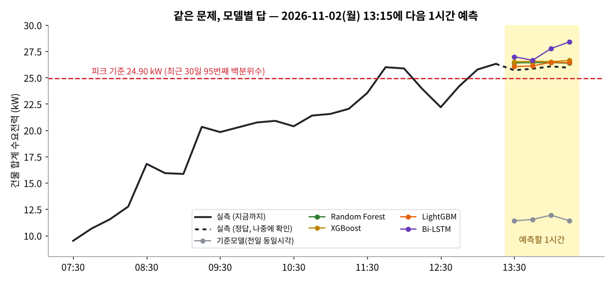
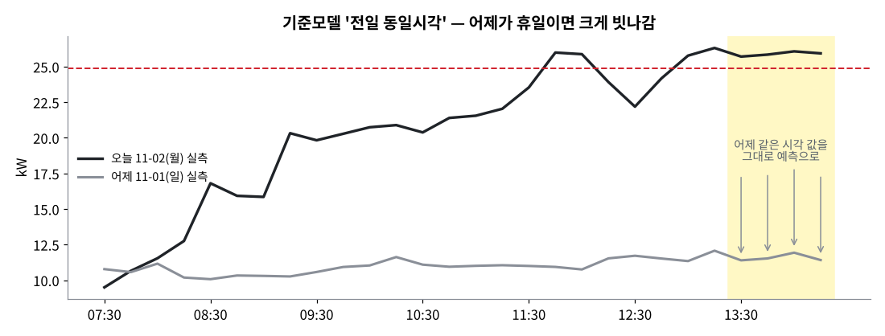
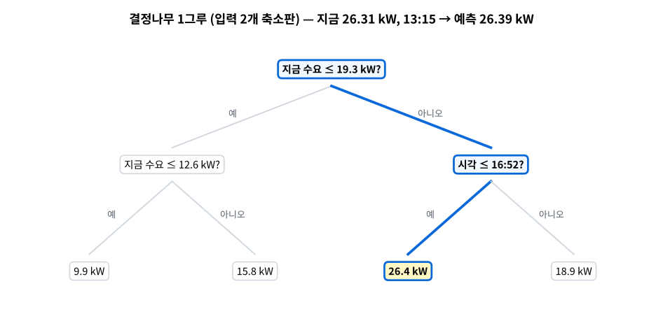
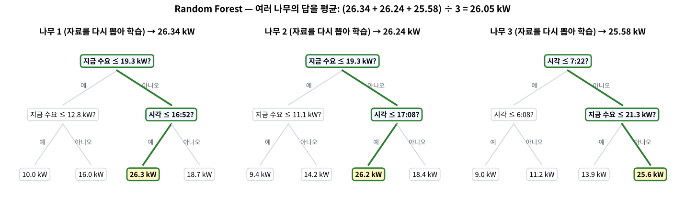
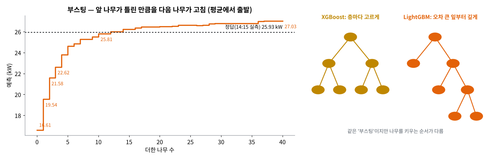
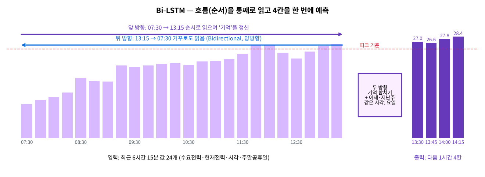
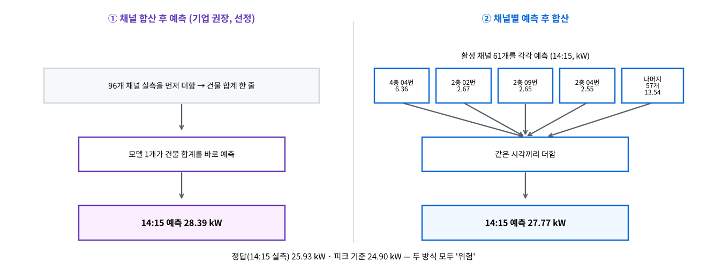
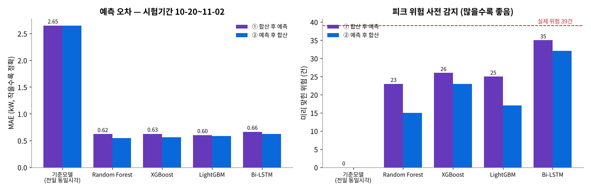

# 피크가드 예측모델 도감

> 팀원 누구나 "우리 모델들이 각자 어떻게 답을 내는지"를 한 장면으로 비교하며 이해하도록 만든 안내서입니다.
> 숫자는 모두 기업 제공 실증 데이터에서 골랐고, 그림은 `python -m peakguard.tools.model_guide` 로 다시 만들 수 있습니다.

## 0. 모든 모델이 푸는 같은 문제

- **질문**: "지금(15분 단위) 건물 전체 수요전력을 보고, 다음 1시간의 15분 칸 4개(15·30·45·60분 뒤)를 맞혀라."
- **판정**: 4칸 중 하나라도 **피크 기준**(최근 30일 15분 값의 95번째 백분위수) 이상이면 '위험', 아니면 '정상' (기업 1차 답변 C1~C3, 추가 답변 2번).
- **이 도감의 예시 장면**: 2026-11-02(월) 13:15. 지금 수요전력 **26.31 kW**, 피크 기준 **24.90 kW**.
  실제 다음 1시간은 **25.70 · 25.84 · 26.07 · 25.93 kW** — 4칸 모두 기준을 넘은 **진짜 위험** 장면입니다.

| 데이터 | 쓴 것 (최소한) |
|---|---|
| 기업 전력 CSV | 96개 채널 수요전력을 같은 15분 칸끼리 더한 **건물 합계** 한 줄 |
| 예시 장면 | 11-02 07:30 ~ 14:15 (지난 6시간 24칸 + 다음 1시간 4칸), 전날 11-01(일) 같은 시각 4칸 |
| 원리 그림용 축소판 | 학습기간(~09-14) 평일 15분 칸 4,242개, 입력은 **지금 수요**와 **시각** 2개만 |
| 성능 비교 | 시험기간(10-20~11-02) 예측 1,155개 시점, 실제 위험 39건 |

| 모델 | 13:30 | 13:45 | 14:00 | 14:15 | 판정 |
|---|---|---|---|---|---|
| 정답 (실측) | 25.70 | 25.84 | 26.07 | 25.93 | 위험 |
| 기준모델 (전일 동일시각) | 11.39 | 11.53 | 11.93 | 11.41 | 정상 → **놓침** |
| Random Forest | 26.40 | 26.42 | 26.43 | 26.37 | 위험 → 맞힘 |
| XGBoost | 26.50 | 26.55 | 26.52 | 26.63 | 위험 → 맞힘 |
| LightGBM | 26.05 | 26.11 | 26.45 | 26.42 | 위험 → 맞힘 |
| Bi-LSTM | 26.98 | 26.65 | 27.76 | 28.39 | 위험 → 맞힘 |

(채널 합산 후 예측 방식 · 시험기간에 실제로 저장된 예측값, 단위 kW)

---

## 1. 기준모델 — 전일 동일시각 (기업이 정한 비교 기준)

**원리 한 줄**: "어제 이 시각에 얼마였으면, 오늘도 그만큼 쓸 것이다."

- 계산: 내일 14:15 예측 = 오늘 14:15 실측. 학습이 필요 없습니다.
- 예시: 전날 11-01은 **일요일**이라 14:15가 11.41 kW였습니다. 그래서 월요일 예측도 11.41 kW → 실제 25.93 kW와 14.5 kW 차이, 위험을 놓쳤습니다.
- 역할: AI 모델이 "이것보다 MAE(Mean Absolute Error, 평균절대오차)를 10% 이상 줄여야 한다"는 기업 목표의 출발선입니다 (1차 답변 D1).

| 장점 | 약점 |
|---|---|
| 아주 단순, 학습 불필요, 누구나 설명 가능 | 휴일 다음 날·장비 사용이 바뀐 날 크게 빗나감, 오늘의 흐름을 전혀 보지 않음 |

---

## 2. 나무 모델의 기초 — 결정나무 (Decision Tree)

Random Forest·XGBoost·LightGBM은 모두 이 **결정나무**를 여러 그루 쓰는 모델입니다. 먼저 한 그루를 봅니다.

**원리 한 줄**: "예/아니오 질문을 차례로 던져 비슷한 과거 사례 묶음(잎)을 찾고, 그 묶음의 평균을 답으로 낸다."

- 아래 나무는 학습기간 평일 자료로 만든 **축소판**(질문 2단계, 입력 2개)입니다.
- 예시(지금 26.31 kW, 13:15): "지금 수요 ≤ 19.3 kW?" → 아니오 → "시각 ≤ 16:52?" → 예 → 그 잎의 과거 평균 **26.4 kW**가 답.
- 실제 피크가드 모델은 질문에 쓰는 입력이 18개(15분 전·1시간 전 값, 어제·지난주 같은 시각, 요일, 주말·공휴일 등)이고 나무도 훨씬 깊습니다.

---

## 3. Random Forest (랜덤 포레스트) — 여러 나무의 '평균' (배깅, Bagging)

**원리 한 줄**: "자료를 조금씩 다르게 뽑아 나무를 여러 그루 키우고, 답을 평균 낸다."

- 나무마다 학습 자료를 **복원 추출**(같은 칸이 두 번 뽑힐 수도 있음)로 새로 뽑고, 질문에 쓸 입력도 무작위로 일부만 씁니다 → 나무들이 서로 조금씩 다르게 자랍니다.
- 예시: 세 그루의 답 26.34 · 26.24 · 25.58 kW → **평균 26.05 kW**. (피크가드 실제 모델은 150그루)
- 한 그루가 엉뚱해도 평균이 이를 눌러 주므로 **안정적**이고 과적합(학습 자료에만 지나치게 맞춤)에 강합니다.

| 장점 | 약점 |
|---|---|
| 안정적, 설정에 덜 민감, 헛경보가 적음 (시험기간 8건) | 평균을 내다 보니 급하게 오르는 피크를 낮게 잡는 경향 → 놓침 16건 |

---

## 4. 부스팅 (Boosting) — XGBoost · LightGBM: 앞 나무의 '실수'를 다음 나무가 고침

**원리 한 줄**: "평균에서 출발해, 나무 한 그루씩 더할 때마다 남은 오차를 조금씩 줄인다."

- Random Forest는 나무들을 **나란히** 키워 평균을 내지만, 부스팅은 나무를 **차례로** 키웁니다. 두 번째 나무는 첫 번째 나무가 틀린 만큼(잔차)을 배우고, 세 번째는 남은 오차를 배우는 식입니다.
- 예시(축소판): 학습 자료 평균 16.61 kW에서 출발 → 나무 1그루 19.54 → 2그루 21.58 → 3그루 22.62 → 10그루 25.81 → 40그루 27.03 kW.
  정답(14:15) 25.93 kW 쪽으로 다가가고, 너무 많이 더하면 지나칠 수도 있어 **학습률**(한 번에 얼마나 고칠지)과 **나무 수**를 검증기간으로 정합니다 ([TUNING.md](TUNING.md)).
- **XGBoost와 LightGBM의 차이**: 둘 다 부스팅이지만 나무를 키우는 순서가 다릅니다.
  - XGBoost (eXtreme Gradient Boosting): **층마다 고르게** 키움 (깊이 4까지 모든 가지를 함께)
  - LightGBM (Light Gradient Boosting Machine): **오차가 가장 큰 잎부터** 깊게 키움 → 같은 시간에 더 빨리 정확해지지만 너무 깊어지지 않게 잎 수를 제한(15개)

| 장점 | 약점 |
|---|---|
| 표 형태 자료에서 정확도가 높음 (시험 MAE 0.60~0.63 kW), 학습이 빠름 | 학습 때 본 값의 범위를 넘는 새 최고값은 잘 못 따라감, 설정값에 민감 |

---

## 5. Bi-LSTM (Bidirectional Long Short-Term Memory, 양방향 장단기 메모리) — 흐름을 통째로 읽기

**원리 한 줄**: "지난 6시간 24칸을 순서대로 읽으며 '기억'을 쌓고, 그 흐름 전체로 다음 4칸을 한 번에 낸다."

- 나무 모델은 "15분 전 값, 1시간 전 값"처럼 **미리 정해 준 숫자**를 보지만, LSTM은 **24칸의 순서(모양)**를 그대로 읽습니다. 그래서 "오전 내내 오르다 점심에 잠깐 내려갔다 다시 오르는" 모양 같은 흐름을 잡습니다.
- **장단기 메모리**: 읽어 가면서 무엇을 기억하고 무엇을 잊을지 스스로 정하는 장치(게이트)가 있어, 오래된 일과 방금 일을 함께 다룹니다.
- **양방향**: 앞에서 뒤로(07:30→13:15) 한 번, 뒤에서 앞으로(13:15→07:30) 한 번 읽어 두 기억을 합칩니다. 여기에 어제·지난주 같은 시각 값과 요일을 더해 4칸을 냅니다.
- 예시: 26.98 · 26.65 · 27.76 · **28.39 kW** — 오르는 흐름을 강하게 읽어 다른 모델보다 높게 예측했습니다(실제보다 조금 높음).
- 피크가드에서는 건물 합계와 채널 61개를 **한 모델로 함께** 학습합니다(채널 구분은 '채널 번호표' 입력으로).

| 장점 | 약점 |
|---|---|
| 오르는 흐름을 일찍 잡아 **피크를 가장 적게 놓침** (39건 중 35건 감지) | 조금 높게 예측하는 경향 → 헛경보가 많음(32건), 학습이 느리고 설명이 어려움 |

---

## 6. 두 가지 예측 방식 — 같은 모델을 어떻게 쓰느냐

| 방식 | 하는 일 | 예시 (Bi-LSTM, 14:15) |
|---|---|---|
| ① **채널 합산 후 예측** (기업 권장, 선정) | 96개 채널을 먼저 더한 **건물 합계 한 줄**을 모델 1개가 바로 예측 | 28.39 kW |
| ② **채널별 예측 후 합산** | 실제로 쓰는 채널 61개를 **각각 예측**한 뒤 같은 시각끼리 더함 | 27.77 kW (4층 04번 6.36 + 2층 02번 2.67 + … ) |

- ②는 채널마다 오차가 서로 상쇄되어 평균 오차(MAE)는 조금 더 작지만, 채널마다 "조금씩 낮게" 예측한 것이 더해져 피크를 놓치는 경우가 늘어납니다.
- 호실별 숫자(점검 우선 Top 5)는 두 방식 모두 같은 모델의 **채널 예측**을 씁니다.

---

## 7. 한눈에 비교 (시험기간 10-20 ~ 11-02, 실제 위험 39건)

| 모델 | 답을 내는 방법 | 비유 | MAE ①/② (kW) | 맞힘 ① | 헛경보 ① |
|---|---|---|---|---|---|
| 기준모델 (전일 동일시각) | 어제 같은 시각 값 그대로 | 달력 보고 어제 따라 하기 | 2.647 | 0 | 25 |
| Random Forest | 여러 나무 평균 | 여러 전문가 의견의 평균 | 0.619 / 0.549 | 23 | 8 |
| XGBoost | 나무를 차례로 더해 오차 고침 (층마다) | 오답 노트를 한 장씩 고쳐 쓰기 | 0.626 / 0.563 | 26 | 20 |
| LightGBM | 같은 부스팅 (오차 큰 잎부터) | 가장 많이 틀린 문제부터 고치기 | 0.600 / 0.586 | 25 | 23 |
| **Bi-LSTM** | 6시간 흐름을 양방향으로 읽음 | 그래프 모양을 보고 다음을 짐작하기 | 0.661 / 0.619 | **35** | 32 |

① = 채널 합산 후 예측, ② = 채널별 예측 후 합산. 맞힘·헛경보는 ① 기준.

**선정**: ① 채널 합산 후 예측 · **Bi-LSTM** — 기업 목표(기준모델 대비 MAE 10% 이상 개선)를 넘은 모델 중 **피크를 가장 적게 놓침**(재현율 90%). 피크가드의 목적은 피크를 놓치지 않는 것이므로 재현율을 먼저 봅니다 ([MODEL_SELECTION.md](MODEL_SELECTION.md)).

---

## 8. 용어 풀이

| 용어 | 뜻 |
|---|---|
| MAE (Mean Absolute Error, 평균절대오차) | 예측과 실측의 차이(절댓값)의 평균. 0.66 kW = 평균 0.66 kW 빗나감 |
| RMSE (Root Mean Square Error, 평균제곱근오차) | 큰 오차에 더 큰 벌점을 주는 오차 |
| MAPE (Mean Absolute Percentage Error, 평균절대백분율오차) | 오차를 실측 대비 %로 |
| 재현율 (Recall) | 실제 위험 중 미리 맞힌 비율 (35/39 = 90%) |
| 정밀도 (Precision) | '위험'이라고 한 것 중 실제 위험 비율 (35/67 = 52%) |
| 과적합 (Overfitting) | 학습 자료에만 지나치게 맞춰 새 자료에서 틀리는 현상 |
| 학습·검증·시험기간 | 배우는 기간(~09-14) · 설정을 고르는 기간(09-15~10-06) · 마지막에 한 번만 성적을 매기는 기간(10-20~11-02) |
| 하이퍼파라미터 (Hyperparameter) | 사람이 정하는 모델 설정값 (나무 수, 깊이, 학습률 등) |
