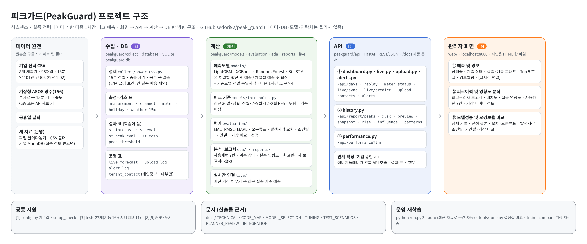

# 팀 파트별 담당 폴더

각자 **자기 파트 폴더**만 수정하면 서로 충돌이 거의 나지 않습니다.
공통 파일(`peakguard/config.py`, `run.py`, `README.md`, `db/schema.sql`)을 바꿀 때는 단톡방에 먼저 알려 주세요.



## 1. 파트 → 폴더 (담당자 칸은 회의에서 채워 주세요)

| 파트 | 하는 일 | 수정할 폴더·파일 | 브랜치 이름 예시 | 담당자 |
|---|---|---|---|---|
| **Front-end** | 건물·호실별 대시보드 화면 설계·구현 | `web/index.html` (화면 배치)<br>`web/static/app.js` (동작·그래프)<br>`web/static/style.css` (디자인)<br>`peakguard/tools/export_static.py` (시연용 HTML) | `front/채널그래프` | |
| **Back-end** | Data Modeling, FastAPI 조회 API, CSV 업로드 | `peakguard/api/` (`dashboard.py` 조회, `compare.py` 채널합산 비교, `upload.py` 업로드, `app.py` 서버)<br>`peakguard/models/grid.py` (DB → 시계열 격자)<br>`peakguard/reports/periodic.py` (보고서), `peakguard/reports/executive.py` (최고관리자 스프레드시트) | `back/api-알림` | |
| **데이터 수집·전처리** | 기상·공휴일·고객 텍스트 수집, 전력 CSV 정제 | `peakguard/collect/`<br>· `power_csv.py` 전력 정제 규칙<br>· `weather.py` 기상청 ASOS<br>· `calendar_kr.py` 공휴일<br>· `reviews.py` 앱 리뷰 크롤링 | `data/기상추가` | |
| **DB 설계·구축, EDA** | 테이블 설계·적재, 사용패턴·피크 분석 | `db/schema.sql` (테이블 정의서)<br>`peakguard/database/` (연결·적재)<br>`peakguard/eda/patterns.py` (분석 그래프) | `db/인덱스` | |
| **모델 영향요인·성능평가** | 예측모델, 피크 기여도·영향요인, 성능평가 | `peakguard/models/` (`features.py` 특징, `lightgbm_model.py`, `random_forest_model.py`, `bilstm_model.py`, `baseline.py`, `train.py`)<br>`peakguard/evaluation/` (`metrics.py` 지표, `report.py` 표·그래프) | `model/기온특징` | |

## 2. 단계 번호 → 파일 (`python run.py 번호`)

| 번호 | 단계 | 파일 | 결과물 |
|---|---|---|---|
| 1 | 환경설정 | `peakguard/config.py`(경로·기준값), `peakguard/setup_check.py`, `requirements.txt`, `.env.example` | 점검 결과 출력 |
| 2 | 데이터베이스 구축 | **`db/schema.sql`(테이블 정의서)**, `peakguard/database/load_power.py`(전력 적재), `peakguard/collect/weather.py`(기상 적재) | `peakguard.db` |
| 3 | 예측모델 | `peakguard/models/lightgbm_model.py`, `random_forest_model.py`, `bilstm_model.py`, `baseline.py`, `train.py` | `models/`, DB 예측 테이블 |
| 4 | 평가 결과 표·그래프 | `peakguard/evaluation/report.py`, `metrics.py` | `reports/eval/` 표 3개·그래프 5개 |
| 5 | API 서버 | `peakguard/api/app.py`, `dashboard.py` | http://localhost:8000 , `/docs` |
| 6 | 화면 연결 | `web/` — 전체 피크 선(`/api/replay`), 채널별 피크 선(`/api/channel`) | 관리자 화면, 시연용 HTML |
| 7 | 동작확인 | `tests/test_smoke.py` | 자동 시험 통과 여부 |
| 8 | 깃허브 반영 | `run.py 8 -m "메시지"` (커밋) | 로컬 커밋 |
| 9 | 깃허브 푸시 | `run.py 9` (받아오기 → 올리기) | GitHub 반영 |
| 10 | 보고서 (주간·월간) | `peakguard/reports/periodic.py`, API `/api/report` | `reports/report_*.txt` |
| 10x | 최고관리자 피크 보고서 (일·주·월·연, 기여도 Top10) | `peakguard/reports/executive.py`, API `/api/report/peaks`·`/api/report/xlsx` | `reports/피크보고서_*.xlsx` |
| 11 | CSV → API 업로드 | `peakguard/api/upload.py`, `peakguard/tools/send_csv.py` | DB에 새 측정값 추가 |
| eda | 사용패턴·피크 분석 | `peakguard/eda/patterns.py` | `reports/eda/` |

## 3. 데이터 흐름 한눈에

```
[수집] 전력 CSV · 기상 · 공휴일 · 리뷰          peakguard/collect/
   ▼
[DB] SQLite peakguard.db                       db/schema.sql, peakguard/database/
   ▼
[예측] 15분 × 4 (다음 1시간)                    peakguard/models/
   ▼
[평가] 오차·피크 감지·영향요인                  peakguard/evaluation/
   ▼
[API] FastAPI                                  peakguard/api/
   ▼
[화면] 관제 현황 · 호실·채널 · 영향요인          web/
```
